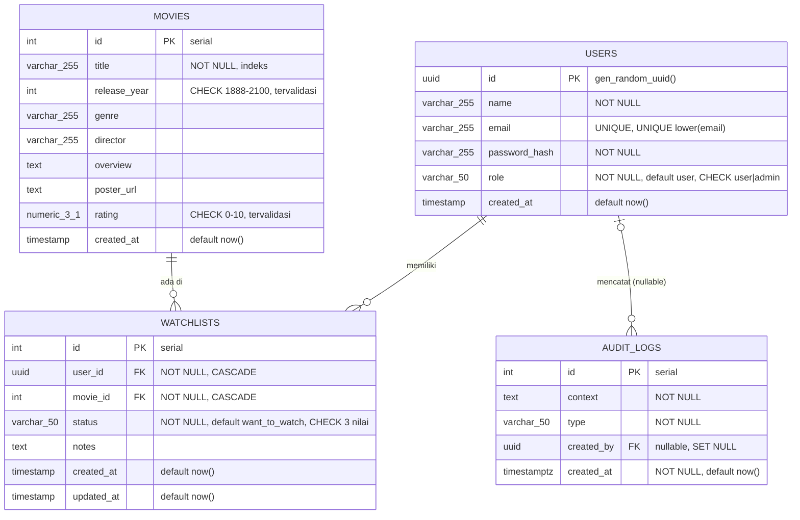

# Dokumentasi Database — CineList

Skema di bawah diambil langsung dari PostgreSQL 17.6 setelah `alembic upgrade head` (head = `0006`). Pemeriksaan `alembic check` menyatakan tidak ada drift antara model SQLAlchemy dan database.

## 1. Diagram



## 2. Tabel

### users

| Kolom | Tipe | Null | Default | Catatan |
|---|---|---|---|---|
| id | uuid | tidak | gen_random_uuid() | PRIMARY KEY `users_pkey` |
| name | varchar(255) | tidak | | Di-set kosong bila registrasi tanpa nama |
| email | varchar(255) | tidak | | UNIQUE `users_email_key`; UNIQUE INDEX `uq_users_email_lower` pada `lower(email)` |
| password_hash | varchar(255) | tidak | | Format `$pbkdf2-sha256$...` |
| role | varchar(50) | tidak | 'user' | CHECK `users_role_check`: `user` atau `admin` |
| created_at | timestamp | ya | now() | Tanpa zona waktu |

Constraint dan index: `users_pkey`, `users_email_key`, `uq_users_email_lower`, `users_role_check`.

### movies

| Kolom | Tipe | Null | Default | Catatan |
|---|---|---|---|---|
| id | integer | tidak | serial | PRIMARY KEY `movies_pkey` |
| title | varchar(255) | tidak | | Index `idx_movies_title` |
| release_year | integer | ya | | CHECK `movies_release_year_range`: 1888–2100, tervalidasi |
| genre | varchar(255) | ya | | |
| director | varchar(255) | ya | | |
| overview | text | ya | | |
| poster_url | text | ya | | Validasi http/https ada di lapisan aplikasi, bukan di database |
| rating | numeric(3,1) | ya | | CHECK `movies_rating_range`: 0–10, tervalidasi |
| created_at | timestamp | ya | now() | Tanpa zona waktu |

Catatan: tidak ada UNIQUE pada judul. Menjalankan seeder dua kali menggandakan film (dicatat sebagai P3).

### watchlists

| Kolom | Tipe | Null | Default | Catatan |
|---|---|---|---|---|
| id | integer | tidak | serial | PRIMARY KEY `watchlists_pkey` |
| user_id | uuid | tidak | | FK `watchlists_user_id_fkey` → users.id ON DELETE CASCADE |
| movie_id | integer | tidak | | FK `watchlists_movie_id_fkey` → movies.id ON DELETE CASCADE |
| status | varchar(50) | tidak | 'want_to_watch' | CHECK `watchlists_status_check`: `want_to_watch`, `watching`, `watched` |
| notes | text | ya | | Batas 2.000 karakter di lapisan aplikasi |
| created_at | timestamp | ya | now() | Tanpa zona waktu |
| updated_at | timestamp | ya | now() | Di-set saat UPDATE oleh repository |

Constraint dan index: `watchlists_user_id_movie_id_key` (UNIQUE `user_id, movie_id`), `idx_watchlists_user_id`, `idx_watchlists_movie_id`.

### audit_logs

| Kolom | Tipe | Null | Default | Catatan |
|---|---|---|---|---|
| id | integer | tidak | serial | PRIMARY KEY `audit_logs_pkey` |
| context | text | tidak | | Deskripsi kejadian; dapat memuat email pada registrasi |
| type | varchar(50) | tidak | | Nilai: `MOVIE_CREATE`, `MOVIE_UPDATE`, `MOVIE_DELETE`, `USER_REGISTER` |
| created_by | uuid | ya | | FK `audit_logs_created_by_fkey` → users.id ON DELETE SET NULL |
| created_at | timestamptz | tidak | now() | Dengan zona waktu |

Index: `idx_audit_logs_created_by`, `idx_audit_logs_type`.

### refresh_tokens (migrasi 0005)

| Kolom | Tipe | Null | Default | Catatan |
|---|---|---|---|---|
| id | uuid | tidak | gen_random_uuid() | PRIMARY KEY `refresh_tokens_pkey` |
| user_id | uuid | tidak | | FK `refresh_tokens_user_id_fkey` → users.id ON DELETE CASCADE |
| token_hash | varchar(64) | tidak | | Hash SHA-256 token; UNIQUE INDEX `uq_refresh_tokens_token_hash`. Token asli tidak pernah disimpan |
| expires_at | timestamptz | tidak | | 14 hari sejak dibuat (`REFRESH_TOKEN_EXPIRE_DAYS`) |
| revoked_at | timestamptz | ya | | Diisi saat logout / ganti password / reset password |
| created_at | timestamptz | tidak | now() | |

Index: `idx_refresh_tokens_user_id`, `uq_refresh_tokens_token_hash`.

### password_resets (migrasi 0006)

| Kolom | Tipe | Null | Default | Catatan |
|---|---|---|---|---|
| id | uuid | tidak | gen_random_uuid() | PRIMARY KEY `password_resets_pkey` |
| user_id | uuid | tidak | | FK `password_resets_user_id_fkey` → users.id ON DELETE CASCADE |
| token_hash | varchar(64) | tidak | | Hash SHA-256; UNIQUE INDEX `uq_password_resets_token_hash`. Sekali pakai |
| expires_at | timestamptz | tidak | | 30 menit (`PASSWORD_RESET_EXPIRE_MINUTES`) |
| used_at | timestamptz | ya | | Diisi saat token dipakai |
| created_at | timestamptz | tidak | now() | |

Index: `idx_password_resets_user_id`, `uq_password_resets_token_hash`.

## 3. Relasi

| Relasi | Kardinalitas | Perilaku hapus |
|---|---|---|
| users → watchlists | 1 : banyak | CASCADE: menghapus user menghapus watchlist-nya |
| movies → watchlists | 1 : banyak | CASCADE: menghapus film menghapus item watchlist yang memuatnya |
| users → audit_logs | 0..1 : banyak | SET NULL: log dipertahankan dengan `created_by` kosong |
| users → refresh_tokens | 1 : banyak | CASCADE: menghapus user mencabut semua sesinya |
| users → password_resets | 1 : banyak | CASCADE: token reset ikut terhapus |

Hubungan user dan film bersifat many-to-many melalui `watchlists`, dengan `UNIQUE (user_id, movie_id)` sehingga tidak ada duplikat.

Penghapusan film diam-diam menghapus item watchlist dari semua pengguna. Ini perilaku yang terverifikasi (`test_cascade_hapus_user_dan_film_membersihkan_watchlist_audit_set_null`). Frontend sebaiknya memberi konfirmasi sebelum admin menghapus film.

## 4. Riwayat migrasi

| Revision | Parent | Isi | Catatan |
|---|---|---|---|
| 0001 | (base) | Tabel users, movies, watchlists, indeks dasar | Setara `legacy_sql/0001_initial_schema.sql` |
| 0002 | 0001 | Tabel audit_logs dan dua indeks | Setara `legacy_sql/0002_audit_logs.sql` |
| 0003 | 0002 | Role dan status NOT NULL, CHECK rating dan tahun (dibuat NOT VALID), UNIQUE lower(email) | Berhenti dengan pesan jelas bila ada email kembar. Status NOT VALID diangkat setelah data diperiksa — lihat bagian 6 |
| 0004 | 0003 | RLS aktif di users, movies, watchlists, audit_logs; grant ke `anon`/`authenticated` dicabut bila peran ada | Tidak mengubah kolom atau data. Downgrade hanya mematikan RLS, grant tidak dikembalikan. |
| 0005 | 0004 | Tabel refresh_tokens (sesi yang bisa diperpanjang) | Hanya hash token yang disimpan. Sudah dijalankan di Supabase 27 Okt 2026. |
| 0006 | 0005 | Tabel password_resets (token lupa password, sekali pakai) | Hanya hash token yang disimpan. Sudah dijalankan di Supabase 27 Okt 2026. |

Urutan yang diuji: database kosong → `upgrade head` → `downgrade base` → `upgrade head` lagi. Semua lulus.

Migrasi 0003 tidak mengubah tipe `TIMESTAMP` menjadi `TIMESTAMPTZ`. Keputusan ini didokumentasikan di file migrasi karena perlu keputusan zona waktu untuk data lama.

## 5. Perbedaan model dan database

Tidak ada perbedaan yang terdeteksi oleh `alembic check`. Perbedaan yang bersifat sengaja:

- Constraint rating dan tahun berstatus VALID di database (diangkat dari NOT VALID — lihat bagian 6). Model SQLAlchemy mendeklarasikannya dengan nama yang sama. Alembic tidak membandingkan status VALID, sehingga status ini tidak menghasilkan drift.
- `movies.created_at`, `users.created_at`, `watchlists.*` memakai `TIMESTAMP`, sedangkan `audit_logs.created_at` memakai `TIMESTAMPTZ`.

## 5b. Keamanan paparan (migrasi 0004)

Di Supabase, tabel di schema `public` dapat dijangkau lewat Data API oleh peran `anon` dan `authenticated`. Migrasi 0004 menutup jalur itu dengan dua lapis:

1. **Grant dicabut.** `REVOKE ALL` pada tabel dan sequence `public` dari `anon` dan `authenticated`, serta default privilege untuk tabel baru. Hanya dijalankan bila kedua peran ada, jadi aman di PostgreSQL biasa.
2. **RLS aktif tanpa policy.** Peran selain pemilik tabel dan selain BYPASSRLS tidak melihat baris apa pun. Ini tetap berlaku bila grant dibuka lagi secara tidak sengaja. Tes `test_rls_menolak_baris_walau_grant_diberikan` membuktikan ini.

Syarat: peran yang menjalankan aplikasi harus pemilik tabel atau memiliki BYPASSRLS. Periksa dengan:

```sql
SELECT current_user, rolbypassrls FROM pg_roles WHERE rolname = current_user;
SELECT tablename, tableowner FROM pg_tables WHERE schemaname = 'public';
```

Kueri verifikasi setelah migrasi (sebagai peran aplikasi, harus `f`):

```sql
SELECT has_table_privilege('anon', 'users', 'SELECT') AS anon_bisa_baca,
       has_table_privilege('authenticated', 'users', 'SELECT') AS authenticated_bisa_baca;
```

## 6. Constraint NOT VALID — sudah diselesaikan

Constraint `movies_rating_range` dan `movies_release_year_range` dibuat berstatus NOT VALID pada
migrasi 0003 supaya migrasi tidak gagal sebelum data lama diperiksa. Status itu sudah diangkat:

```sql
SELECT id, rating, release_year FROM movies
WHERE (rating < 0 OR rating > 10) OR (release_year < 1888 OR release_year > 2100);
-- Hasil pemeriksaan: 0 baris

ALTER TABLE movies VALIDATE CONSTRAINT movies_rating_range;
ALTER TABLE movies VALIDATE CONSTRAINT movies_release_year_range;
-- Hasil: kedua constraint berstatus VALID
```

Catatan: aturan rentang tetap ditegakkan untuk data baru walau berstatus NOT VALID; pengangkatan
status ini yang membuat data lama ikut diperiksa. Dijalankan manual (bukan lewat migrasi) karena
bergantung pada kondisi data. Bila database dipasang ulang dari nol, constraint dibuat NOT VALID
lalu langsung divalidasi karena tabelnya masih kosong.

## 7. Arsip

`migrations/legacy_sql/` dan `docs/archive/database_schema_lama.md` adalah dokumen sejarah. Keduanya tidak dipakai oleh aplikasi atau Alembic. Tabel lama `reviews`, `favorites`, dan `collections` tidak ada dalam skema aktif.
