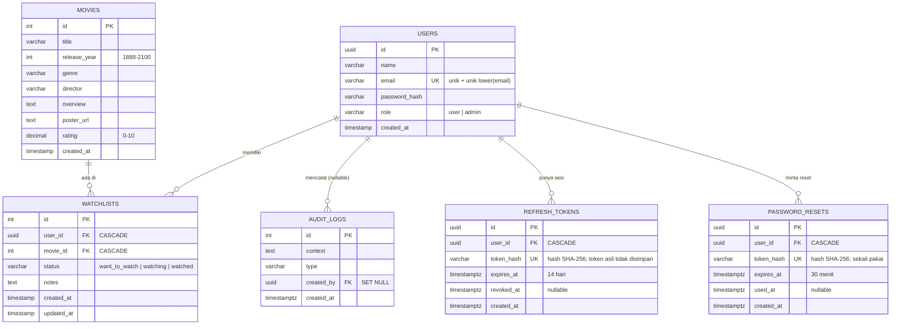

# ERD (skema aktual, head 0006)

Catatan:
- `WATCHLISTS` punya `UNIQUE (user_id, movie_id)` sehingga hubungan user–movie bersifat many-to-many tanpa duplikat.
- `REFRESH_TOKENS` dan `PASSWORD_RESETS` menyimpan **hanya hash SHA-256**, bukan token aslinya. Keduanya ditambahkan di migrasi 0005/0006 (27 Oktober 2026) untuk fitur perpanjangan sesi dan lupa password.
- Tabel `reviews`, `favorites`, `collections` pada dokumen lama **tidak ada** di skema aktif (lihat `docs/archive/`).
